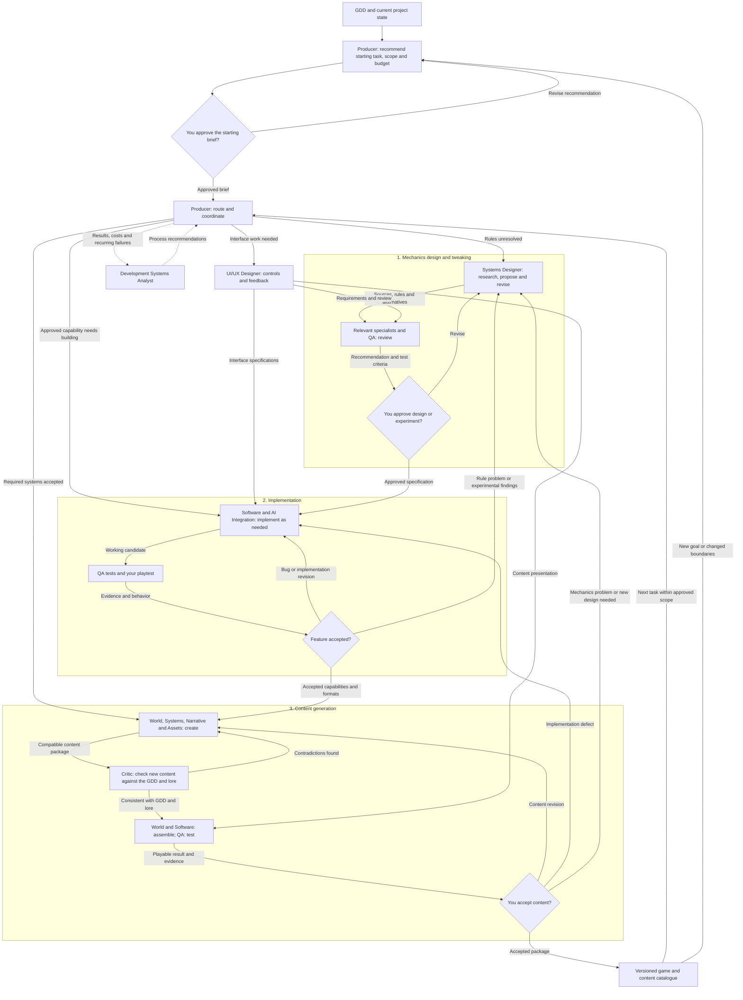

# Process B — Delve Deeper game-development workflow

Status: instructions for defining and operating the future development crew. Enter this process only after the definition-process readiness review and the user's approval to proceed. This document does not resolve the GDD's TBDs or claim a crew has already been implemented.

## Purpose and structure

Build a reusable development studio for Delve Deeper: establish a playable base game with bounded content, then repeatedly extend its systems and generate additional content. Keep the ambitious long-term design while allowing the game to run with the GDD's limited demo content.

The studio has three connected workflows:

1. **Mechanics design and tweaking:** determine how the game should work, resolve TBD decisions, and improve rules and balance.
2. **Implementation:** build approved behavior and reusable tools, then verify that they work.
3. **Content generation:** create, assemble, and validate encounters, creatures, items, floors, and side-dungeons using those systems.

Each workflow has its own review-and-revision loop. Passing a gate produces a versioned result that another workflow can safely use. Testing can reopen an earlier decision. A small amount of test content can support design and implementation before the production systems are stable.

The Producer routes a job according to what is missing. Undefined or disputed rules enter design; approved but unbuilt behavior enters implementation; content supported by accepted systems enters content generation. A job does not need to visit every stage if its prerequisites already exist.

## Startup and relationship to the definition project

This is the second of two process documents. The definition team first creates its own definitions under Process A, then uses those to create all ten development definitions for this document. Producer, Development Systems Analyst, Software Engineer, and QA Tester have distinct definitions in the two processes. Do not let a development invocation continue agent-definition work by accident.

After the user approves transition to development, the development Producer reads the GDD, accepted definitions, project state, dependencies, and available tools. It recommends a concrete first task, scope, outputs, acceptance criteria, and budget or explicit effort bounds. Present a concise recommendation for the user's approval. Do not ask the user to invent the starting task. This is the first planned human input in the development process. The earlier definition project has its own readiness briefing.

Approval activates that bounded development brief. If rejected, revise the recommendation. Subsequent tasks within approved boundaries can proceed without repeatedly requesting the same approval; new scope or consequential changes return to the user. No particular encounter or mechanic has been preselected by this package.

## The development roles

| Agent | Responsibility across the three workflows | Concrete outputs |
|---|---|---|
| Producer | Maintains the work and decision queues; selects agents; sequences dependencies; tracks budgets; routes findings and human reviews. | Bounded briefs, dependencies, task status, artifact references, review packets. |
| Development Systems Analyst | Evaluates the crews process, repeated failures, context use, and cost per accepted result. | Evidence-backed recommendations for prompts, tools, task sizing, and workflow changes. |
| Systems Designer | Owns mechanics proposals, interactions, balance experiments, tuning, and gameplay definitions. | Options and tradeoffs, formulas, parameter tables, test criteria, versioned rules and content data. |
| World Designer | Evaluates spatial implications and creates layouts, routes, placements, secrets, puzzles, and floor connections. | Layout specifications, placement data, assembled Unreal maps. |
| UI/UX Designer | Checks whether mechanics and content can be understood and controlled; defines presentation and feedback. | Controls, interface specifications, wireframes, messaging and feedback requirements. |
| Narrative Designer | Maintains lore, identities, voices, values, revelations, negotiation text, and assessment profiles. | Narrative constraints, game text, profile data, dialogue and string tables. |
| Software Engineer | Builds gameplay systems, data formats/importers, saving, shared interfaces, tools, integration, and builds. | Code/Blueprints, schemas, importers, simulations/prototypes, integrated candidates. |
| AI Integration Engineer | Builds the runtime assessment pipeline and its approved behavior. | Prompts, API connections, response validation, retry/resume handling, logs and tests. |
| Asset Curator | Selects, prepares, adapts, or creates resources consistent with the approved style and available collections. | Usable assets, references, source/license records. |
| QA Tester | Checks designs for testability; tests behavior, data, integration, compatibility, and regressions. | Test cases, validation results, reproducible defects, verified fixes. |
| Critic | Checks NEW content against the GDD and the accepted lore for contradictions, right after content is generated and before it is assembled (box CR in the workflow). Judges neither quality, fun nor balance, and rewrites nothing. | A report with verbatim, line-numbered quotes and a verdict: CONSISTENT or CONTRADICTIONS. |

These are the available roles: ten from the GDD and the Critic, added by the user as an eleventh. Every role must be tasked or consulted in each task; the Producer may bench a role only after consulting it. The Producer activates the roles needed by a particular job. UI/UX joins when controls or presentation are affected; AI Integration joins when runtime assessment behavior is affected. Independent tasks can run in parallel after shared inputs and ownership are agreed. A run that costs more than its model's limit (Sonnet 1.00 USD, Haiku 0.25 USD) is flagged, and the Producer has the Development Systems Analyst assess it from the raw logs alongside the normal work, never instead of QA.

The Systems Designer evaluates game mechanics. The Development Systems Analyst evaluates how the development crew works. The Analyst supports all three workflows without becoming a fourth production stage.

## Overall Mermaid diagram

The diagram starts with the Producer recommending the first task for human approval. The boxes then group work by workflow. Every acceptance gate requires the relevant checks and applicable human review. Approved tuning authority can carry forward without another identical request.

Design approval is yours for new or changed mechanics. A tuning adjustment within a range and authority you have already approved can inherit that approval. Completed features and content still receive the applicable human review before becoming an accepted basis for dependent work.

The diagram abbreviates routing. A content request for an already-designed but unimplemented capability goes directly to implementation. A feature can be accepted and recorded without immediately starting a content job. When a defect returns upstream, the Producer retains the waiting job and resumes it after its affected prerequisites are accepted.

## 1. Mechanics design and tweaking

**Entry:** a GDD TBD, an interaction the GDD does not resolve, an expansion requirement, a playtest finding, or evidence that an existing mechanic needs adjustment.

1. **Frame the question — Producer and Systems Designer.** Record the intended player experience, existing GDD requirements, unresolved choices, dependencies, available evidence, budget, and the decision needed. Maintain a decision register distinguishing TBD, proposed, experimental, and approved rules. Never silently promote an assumption into an approved rule.
2. **Develop concrete options — Systems Designer.** Propose suitable alternatives, formulas or procedures, initial values, adjustable parameters, expected outcomes, and tradeoffs. Examine interactions with progression, combat, negotiation, rest, rewards, relationships, and other affected systems. Give a recommendation and explain its assumptions.
3. **Review across disciplines — relevant specialists and QA.** World checks spatial and encounter implications; Narrative checks lore and character behavior; UI/UX checks player understanding; Software checks feasibility; AI Integration checks assessment implications. QA identifies edge cases, exploits, and ways to test the proposed behavior.
4. **Approve a direction or experiment — you.** Decide consequential rules and tradeoffs. Record which values agents may tune, within what limits, and what evidence is needed. A prototype may be approved as an experiment without making its rules final.
5. **Evaluate and refine — Systems Designer, supported by Software and QA.** Use calculations, scenario comparisons, or bounded simulations where useful. A playable prototype is an implementation job linked to this design question; its results return here. Your playtest supplies evidence about feel and enjoyment. Systems proposes changes based on results.
6. **Accept the design or repeat.** If the proposal fails its goals, return to the relevant earlier step. Accepted rules, parameters, tests, and rationale become a versioned specification. Experimental behavior remains marked experimental until adopted.

**Pass forward:** an approved, sufficiently precise design with defined behavior, adjustable values, affected interfaces, acceptance criteria, and any explicitly deferred questions.

**Loop back:** poor results, unclear behavior, contradictions, unacceptable tradeoffs, or an unresolved choice that blocks the feature.

The design need only resolve the decisions required by the current job. Unrelated TBDs can remain queued. Blocked work does not prevent independent, approved work from continuing.

**Example: negotiation.** The GDD leaves parts of the formula open. Systems proposes ways for stats, level, gifts, and creature preferences to affect outcomes. Narrative checks whether the proposed responses fit the creatures; QA checks repeat-reward exploits; Software provides a test harness when useful. You approve the intended behavior and the authority to tune it. No formula in this example is being selected by this workflow proposal.

### Comparable-game research

Systems Designer owns internet research into comparable mechanics, including the GDD's reference games where relevant. The Producer bounds the research question. Record source URLs, versions/editions, relevant findings, and confidence. Distinguish documented behavior, player measurements, speculation, and the agent's inference. Compare interactions and tradeoffs before recommending an adaptation for Delve Deeper. Other specialists research their own domain when needed. External sources supply evidence; they do not override the GDD or human decisions. If browsing is unavailable, report the evidence gap rather than inventing source verification.

## 2. Implementation

**Entry:** an approved mechanic, an approved experiment, a missing tool or capability, an implementation defect, or an approved parameter change requiring integration.

1. **Plan the work — Producer and engineering agents.** Turn the specification into bounded tasks with owners and dependencies. Identify shared code, Blueprint, data, map, save, and runtime-AI changes. Obtain your approval for consequential architecture or scope decisions.
2. **Build the candidate — Software Engineer and relevant specialists.** Implement gameplay and reusable components. AI Integration handles the assessment pipeline; UI/UX supplies presentation requirements; World and Assets support the test environment. Keep variable content in reusable definitions and avoid hard-coding demo counts as universal limits.
3. **Verify against the design — QA.** Run appropriate deterministic tests, integration checks, edge cases, save/reload checks, and regressions. Compare observed behavior to the approved specification. An incorrect implementation is a bug; faithfully implementing a rule that produces an undesirable result is a design finding.
4. **Review the playable behavior — you.** Receive a working candidate and a concise account of tests, known limitations, and decisions needed. Experimental implementations return evidence to mechanics design. Completed features require your acceptance before dependent production treats them as established.
5. **Correct or accept.** Bugs return to engineering. Rule problems return to mechanics design. Accepted implementations update the available-capability record, schemas, tests, and documentation; the Producer resumes dependent work.

**Pass forward:** a tested, accepted capability with working content formats/tools, a playable reference or suitable demonstration, documented limits, and repeatable checks.

**Loop back:** failing tests, incorrect behavior, implementation quality issues, or your requested revisions. Design changes return to Part 1 before dependent changes proceed.

For an approved tuning change, this stage may involve updating a parameter table and running tests. It does not require rewriting code when the established data system already supports the change.

“Stable” means dependable enough for the intended content at the current version. It does not mean that the mechanic is permanently frozen.

## 3. Content generation and testing

**Entry:** an approved content brief whose required rules and capabilities have been accepted.

1. **Define the job and check prerequisites — Producer.** Record purpose, content type, location/depth, difficulty, size, budget, lore limits, expected outputs, and success criteria. Consult the catalogue for reusable material and duplication. Route undefined mechanics to design and missing implementations to engineering.
2. **Develop the concept — World, Systems, and Narrative.** Agree on routes, challenges, encounters, rewards, identities, and allowed revelations. New consequential creative decisions go to you; routine variations can inherit an approved brief.
3. **Generate compatible pieces — relevant specialists.** Systems creates creature/item/trap/spell data and balance values; Narrative creates text, identities, and profiles; Assets prepares resources; World creates layout and placement. UI/UX and AI Integration participate where existing presentation or assessment support needs approved changes.
4. **Assemble a playable candidate — World and Software.** Populate maps, validate references, import data, and integrate the package in a working candidate. Use accepted tools and formats. Assembly does not silently introduce new mechanics.
5. **Test and classify findings — QA, coordinated by Producer.** Check data validity, reachability, solvability, difficulty, rewards, lore consistency, performance, and compatibility. Route each finding to its actual cause, preserving unaffected approved work.
6. **Playtest, revise, and accept — you and the responsible agents.** Review the playable package and test evidence. Content revisions repeat this workflow; implementation defects return to Part 2; rule problems return to Part 1 and then Part 2. Accepted content is versioned and added to the project and catalogue.

**Pass forward:** accepted, playable content with stable IDs, dependencies, relevant lore records, test evidence, and a record of the rules/capabilities used.

**Loop back:** deficient content, unresolved defects, or a requested revision. Passing automated checks does not establish that the content is enjoyable.

The workflow can repeat for another approved package without redesigning the foundation each time. Release or publication is a separate decision where relevant; acceptance does not automatically publish the result.

For a new main floor, define neighboring-floor connections and progression. For a custom side-dungeon, define its isolated map, single portal, appropriate entry difficulty, permitted lore, and reward limits. Evaluate meaningful differences against the catalogue without promising absolute uniqueness. Balance review protects the GDD's intention that paid side-dungeons avoid pay-to-win advantages.

## How feedback moves between workflows

| Finding | Destination | What happens before dependent work resumes |
|---|---|---|
| Map is dull, a passage is blocked, or an encounter is poorly placed | Content generation | Revise the relevant content and retest it. |
| Code behaves differently from the approved rules | Implementation | Reproduce, fix, and verify the defect, including affected regressions. |
| Implemented rules work as specified but produce undesirable play | Mechanics design | Review the rule or tuning, approve the required change, integrate it, and retest affected content. |
| Expansion requires behavior not yet designed | Mechanics design | Resolve the design, implement it, then resume the expansion. |
| Expansion needs an approved capability that has not been built | Implementation | Build and accept the capability, then resume the expansion. |
| Balance change fits an approved tuning range | Systems-led tuning, then integration and QA | Record the adjustment and verify its consequences within the delegated authority. |
| Repeated failures arise from prompts, task size, handoffs, or context use | Development Systems Analyst | Propose a process correction; approve it where it changes agreed constraints or authority. |

Acceptance is version-specific. When an approved mechanic changes, the Producer identifies dependent systems and content, invalidates affected approvals/checks, and schedules the necessary retesting. Unrelated accepted work remains usable.

## Establishing the base game, then expanding

1. Choose a small playable loop from the GDD and identify the decisions that block it.
2. Resolve those mechanics through Part 1 and build them through Part 2. Temporary test content provides evidence.
3. Repeat design and implementation for the capabilities needed by the approved demo, reviewing completed features before dependent work relies on them.
4. Use Part 3 to produce the demo's bounded content, returning upstream when testing exposes a design or implementation issue.
5. Prove reuse with another small content package made through the same tools and formats.
6. Continue with new approved packages. Existing capabilities support routine content production; additions and improvements reenter design and implementation as needed.

The game can run with minimal content while retaining room for ongoing expansion. The crew works through bounded, authorized jobs with budgets and stop conditions; “indefinitely” describes a reusable process for future work, not one unbounded agent run.

Future four-character party behavior remains a planned capability addition. Shared definitions and stable references should accommodate future growth without requiring all future features to be built before the demo.

## Human authority and handoffs

You approve the game direction, consequential mechanics, architecture, scope, art direction, budgets, and completed features/content. Agents perform routine work within those approvals. A range of delegated tuning authority prevents every numerical adjustment from becoming another human decision.

Every task carries its ID, approved brief, relevant source/version references, inputs, output paths, owner, dependencies, acceptance criteria, tuning authority where applicable, and budget/stop condition. Results return actual artifacts, evidence, status, and unresolved issues.

Keep the decision register, approved rules, capability record, content catalogue, and tests in compact project files. Give agents the records relevant to their task. Give shared files and Unreal maps clear owners; parallelize independent work, then wait for prerequisites before integration.

Repeated unsuccessful revisions or exhausted budgets produce a concrete blocker for you. Preserve completed work and explain what decision or resource is needed to continue.

## Validation specific to Delve Deeper

- Maps have reachable entrances/exits and solvable locks/puzzles under the intended character capabilities.
- Combat follows approved real-time action timers and fixed combat positions, with free movement outside combat.
- Fight, flee, and negotiation outcomes and rewards follow approved rules, including protection against unintended repeat rewards.
- Successful and interrupted rest both advance the day; only successful rest grants the associated recovery and advancement.
- Wait after death produces one assessment batch for the elapsed interval; relationships remain specific to the active character.
- Assessment results validate correctly; completed assessments persist across save/reload without being applied twice; required failed assessments are not silently skipped.
- Boss responses follow standing, and using the descent completes the demo.
- Changes preserve affected save references and existing content, and meet approved performance and difficulty/reward goals.

QA supplies repeatable evidence. Your playtesting evaluates feel, mystery, style, and enjoyment.

## Runtime AI and development agents

The GDD's seven runtime assessors are three NPCs, three gods, and one faction. The boss belongs to the faction assessment rather than being an eighth assessor. The development crew designs, implements, and tests this runtime system.

Runtime assessors respond during play using the approved profiles, recorded actions, prior relationships, and elapsed time. The game validates results and applies authored consequences. Runtime assessments do not redesign mechanics or generate expansion packages.

New consequence behavior enters mechanics design, then implementation. The GDD's all-models-failed behavior remains a decision for that loop to resolve; this proposal does not invent its answer.

## Assignment demonstration

The assignment requires three or more agents to coordinate and produce game-ready output without crashing, plus a Mermaid diagram and README naming the game and explaining the output. The lecture permits raw orchestration with agent instruction files; definitions and a diagram alone do not demonstrate a working crew.

A proposed demonstration is one first-floor encounter package. Resolve only the mechanics it needs, implement/import the required behavior or data, and generate a usable encounter with gameplay definitions, text, references, and placement. Producer, Systems, Narrative, Software, and QA provide a clear coordination chain; World joins where placement requires it. This is a proposed scope, not an approved encounter design.

The complete studio is the architecture. The submission should identify which portion actually runs and which portions remain planned. Include the working orchestration, generated output, validation evidence, diagram, and README. Building the full base game is not necessary to demonstrate coordinated game-ready output.

## Sources

- [Delve Deeper - Final GDD-1.pdf](https://drive.google.com/file/d/1gxWDwBgzKo3nuKX3zGWVok8HsR3q2JoR/view?usp=drivesdk): game direction, TBD mechanics, development roles, ongoing expansion, and human review.
- [Assignment #3 in Google Classroom](https://classroom.google.com/c/ODc4MDQ1MTE0ODcz/a/ODc4MDQ1MTE0OTI5/details): previously inspected live instructions.
- [Assignment attachment](https://docs.google.com/document/d/1wZy6ngsUedOjSdG9Ht7uq7Bi_7kQcK0h3Oosb5lYKQA/edit?usp=drivesdk):.
- [The Virtual Studio lecture transcript](https://chatgpt.com/library?file_id=libfile_64e923c1f71c8191908ad69b82330e6c&account_id=personal): concrete game-ready output, structured roles and handoffs, bounded tasks and dependencies, validation, raw orchestration, and human checkpoints.
- The user's clarification that mechanics design/tweaking, implementation, and content generation should have distinct iterative workflows.

