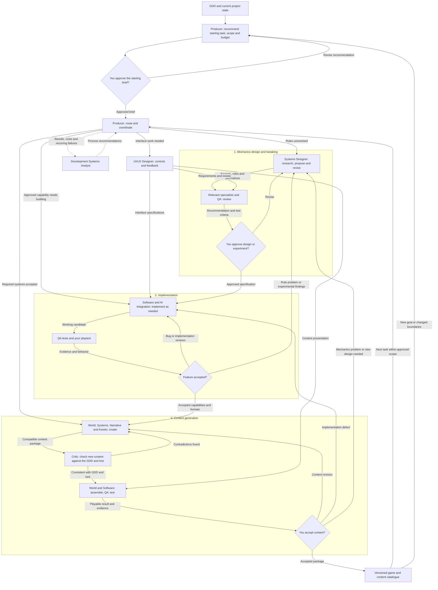

# Delve Deeper: Content Pipeline

**Start here.** In a Claude Code session, paste this and send it:

> Read the README.md in the folder "Delve Deeper - Content Pipeline - 2026-11-08" and start the pipeline.

Claude will answer with one question from the Producer. From then on, every decision is yours.

**If you are Claude reading this:** read `CLAUDE.md` in this folder first, even if your session did not load it, and follow its section for the chat session. Do not answer the pipeline's questions yourself.

## What this is
*Delve Deeper* is a PC dark-pulp-fantasy first-person dungeon crawler (course capstone; full design in `08_Final_GDD_Extracted.txt`). This folder is a pipeline that uses a crew of eleven Claude agents (the ten development roles plus a critic) to produce development content for it: mechanics research and design, monsters, encounters, text, layouts, asset leads, code and tests. It works from the game design document (GDD), and what you ask for comes from you.

The start file is `run_pipeline.py`. It reads the workflow diagram `03_DEVELOPMENT_WORKFLOW.mmd` and walks it one step at a time. It asks you every "You ..." question itself, so no agent can answer one for you.

It succeeds the ten-agent crew from Assignment 3, whose folder ("Delve Deeper - Agent Crew SUBMISSION - 2026-11-04") is unchanged. In that run, the starting task was pre-written into the Producer's brief, and the approvals were stand-ins written by the coordinating session. Here the program asks you.

## What you need
- Claude Code, in a session where Python 3 (3.8 or newer), PyYAML and the `timeout` command are available. The Claude Code cloud session this folder was built in has all three. On your own computer, install PyYAML with `python3 -m pip install pyyaml`.
- A Claude account that pays for usage. The agents run on it.

To check the setup without running anything, run `python3 run_pipeline.py --check`.

## What happens after you paste the prompt
1. Claude reads this file and `CLAUDE.md`, then runs `python3 run_pipeline.py` from this folder.
2. The program prints **"Producer: How can I help with development?"** Nothing else has run. Claude shows you that text and waits.
3. You answer in your own words, for example "generate 3 monsters", or "research existing RPG systems for our mechanics and get the team's input on coding effort and fit with our world and story". Claude writes your words, unchanged, to `pipeline_state/reply.txt` and runs the program again.
4. The program starts the Producer for the first box of the diagram. The Producer reads the GDD and writes a proposal: scope, outputs, acceptance criteria and a budget.
5. The program stops and shows you the proposal and a list of choices: **Revise recommendation, Approved brief, End this task here.** You reply with the exact words of one choice (any capitals, anywhere in the reply), plus notes if you like. A reply naming no choice, or two different choices, picks nothing and the question is asked again.
6. If you approved, the program moves along the diagram. At each box it starts the Producer again; the Producer starts the specialist agents that box allows. Every "You ..." diamond (design approval, feature accepted, content accepted) stops the program and asks you, with the review packet and the choices that diamond has in the diagram.
7. A task ends when you accept the package and choose the diagram's "New goal or changed boundaries" arrow (the program then asks the opening question again), when you choose "End this task here", or when its budget is spent and you decline to raise it.

## The workflow it follows
This is `03_DEVELOPMENT_WORKFLOW.mmd`. The program reads the arrows from this file, so changing the file changes what the pipeline allows. Boxes are the Producer's and the specialists' work; diamonds are your decisions. New content passes through the **critic** box (CR) before it is assembled.

## What the program enforces, and what it only asks for
**The program enforces** (`run_pipeline.py` and the guard in `orchestration/invoke_agent.sh`):
- The next box is always an arrow of the diagram. When a box has several arrows out, the Producer names one, and the program rejects any name that is not an arrow.
- Every "You ..." diamond is shown to you, and only your reply moves it on. The program records your replies word for word in `pipeline_state/tasks/<task>/decisions.md`.
- Which roles may work in each box is listed in `pipeline.json`. A role not listed for the current box is refused (exit 6) when the Producer tries to start it.
- No agent can be started by hand outside the pipeline, and the Producer cannot start another Producer.
- The budget you approve at the starting-brief decision limits the task: once the task's recorded spending reaches it, no new agent run starts until you raise it or end the task. Runs already in progress finish first, so spending can pass the budget by what those runs cost (each is capped at 2.00 USD).
- New content is checked by the critic (`development-critic`) before it is assembled. The critic compares it with the GDD and with `work/lore.md` (which starts empty and only gains what you accept). Every quote in its report is verified by `orchestration/verify_quotes.py` against the cited file and line; a quote that does not match fails the box. The report's verdict must match the arrow the Producer picks. The loop back to content creation ("Contradictions found") may run twice per task; after that you are asked whether to go round again or go on to assembly.
- A box that lists specialists in `pipeline.json` must actually run at least one of them (the program checks the run ledger). The Producer cannot do their work itself and report it as done.
- A box that changes anything in `pipeline_state/` is treated as failed, and you are told.
- The program checks, before running anything, that every box in the diagram has an entry in `pipeline.json` and every named role has a role file.
- **Packet checks** at every decision: the packet must have 'Test evidence and known limits' and 'Decisions needed' sections; the starting-brief packet must also have a 'Budget' section (prices and token assumptions stated, QA on its own row, both Haiku price tiers) and a 'Roster' section; a packet that says 'see ISSUES' must have an ISSUES section. A failed check stops the box and you are told what is missing.
- **Roster rule:** the Producer may never drop an agent. The Roster section has one line for each of the ten specialists: TASKED, or CONSULTED then TASKED, or CONSULTED then BENCHED. Benching an agent that was not consulted first, or claiming a consultation that has no run in the ledger, fails the box. The program writes the result to `work/<task>/roster.md`, and the Development Systems Analyst receives it.
- **Consultations** (boxes P0 and P only): the Producer may ask any other agent, read-only (`Read Glob Grep`, cap 0.30 USD, label containing `-consult-`), whether it sees a job. The reply ends `CONSULT-REPLY: AGREE` or `DISAGREE`. A consultation never replaces work or QA.
- **High-cost flags:** a run over 1.00 USD on Sonnet or over 0.25 USD on Haiku is flagged (`pipeline.json`, `cost_flags`). The Producer is told, and sends the Development Systems Analyst (label containing `-flag-`) to assess it from the raw logs, alongside the normal work, never instead of QA. An assessment is `work/<task>/flags/<flag label>.md` ending in a `Verdict:` line. Your question shows how many flags are open and assessed. The per-run cap is unchanged.
- **Model check:** after each box, the model each run was actually served (from the log) must match `orchestration/models.json`, or the box fails and says which.
- **Stuck-run detector:** a box with no activity for 15 minutes (`stuck_minutes`) is stopped and you are told why.
- **Build tools:** only the Software Engineer and QA may run compilers (g++, gcc, clang, cmake, make, ninja, ctest), through the wrapper `orchestration/run_check.sh`, which runs one allowed command, or a program inside `work/`, and prints `EXIT=<code>`. The Systems Designer alone has WebFetch.

**Agents are only asked to** (the role files and each step's brief): do good work, stay within their brief, cite sources, label what they ran versus reasoned about, and keep GDD unknowns marked as unknown. Nothing checks the quality of what they write. The program cannot tell whether a design is good, and it cannot prove that the words Claude passes along in the chat are yours: `CLAUDE.md` tells Claude to relay only what you typed.

## Where things go
- `work/<task>/`: everything the agents produce for a task (briefs, specifications, data, packets, the critic's report), plus `work/catalogue.md` and `work/lore.md` once a package is accepted.
- `pipeline_state/`: the program's own records: `state.json`, `message_for_user.md` (the question waiting for you), `tasks/<task>/` (request, your decisions, step history, each step's brief and log) and `replies/` (every reply you gave).
- `agent_design/tests/run_ledger.csv` and `agent_design/tests/logs/`: one ledger row and one JSON log per agent run, including cost.

## Data you supply (`work/inputs/`)
No agent can reach Google Drive. When you name data for the team, the chat session (Claude) asks your approval, then copies the files byte for byte into `work/inputs/` and checks each size. Every brief lists what is there. Currently in it: the mordor combat research (START HERE note, audit, JSON data, mechanics PDF, play guide, zips, the OpenDejenol reference and source) and the Avatar PLATO rules, plus `MISSING_FILES.md`. Two files are missing on purpose; see the last section of this file.

## What the Producer is told at every step
The program writes the Producer's brief fresh at each step. Besides the box it is doing, the brief now lists the whole team: each agent's model (`orchestration/models.json`), its tools (`orchestration/allowlists.json`), its one-line description from its own role file, and what no agent can reach (Google Drive, Unreal). It also carries the inputs available, the measured cost history (`orchestration/cost_history.md`), the consultation and roster rules, build-tool advice (an engine-neutral C++ core with a thin Unreal layer) and the open cost flags. It also carries the current price per million tokens for each model, fetched by the program just before the step: first from Anthropic's pricing page, then, if that fails, from the Vercel AI Gateway model list. If both fail the brief says FAILED, and the Producer must say it has no current prices before giving any remembered price, labelled "PAST REMEMBERED PRICE (not verified)".

## Cost
Each agent run is capped at 2.00 USD, and a task stops starting new runs once it reaches the budget you approve (see above for how far it can overshoot). Cost is not known in advance. For scale only: the Assignment 3 run made 37 agent runs and cost 11.90 USD (Claude Sonnet 5.5 at medium effort), and the spend of any new task depends on its size.

## What has and has not been tested
- **Tested, free, repeatable:** `python3 tests/test_pipeline.py` runs 49 checks using a stand-in for Claude Code (`tests/fake_claude/claude`): the diagram's arrows, your questions and string replies, allowed roles, budget, tampering, skipped specialists, the critic step and its quote check and loop limit, price fetch and failover, model check, packet checks, roster and consultations, high-cost flags, the stuck-run detector, `run_check.sh`, the tool allowlists and what the Producer's brief contains. All 49 pass in the current folder. Writing them found a real bug (the Producer's own consultation and flag lists were being blanked), now fixed.
- **Proven live on 2026-11-11 (real model runs, small caps, in a scratch copy, not in your task):** (1) the Producer's shell passes the guard's settings to the commands it runs: a real Producer started the way the pipeline starts it ran a consultation (world designer, Haiku, read-only, 0.0056 USD, reply `CONSULT-REPLY: AGREE`) and, in a second run, a flag assessment by the Analyst (Sonnet, label `-flag-`); the guard accepts those only if the variables arrived. (2) Haiku honors the effort setting: the same question took 143 thinking tokens at low and 763 at max. (3) A Haiku role (Systems Designer) and the Critic ran live and were served `claude-haiku-5-5` and `claude-sonnet-5-5`, as `orchestration/models.json` says. (4) WebFetch works when granted (a Haiku run fetched example.com for about 0.004 USD).
- **Not yet proven:** a whole task with real agents end to end; that the Producer follows its step brief over many steps; the quality of what agents write (nothing checks it); the Critic against real content (it ran on a trivial brief only); Unreal (nothing has run in it; the sandbox has no Unreal and no .NET, so the headless reference in `work/inputs/` cannot be run here).
- **No generated outputs yet.** `work/` holds only your inputs and the first task's records.

## Folder map
- `README.md`, `CLAUDE.md`: this file; and the rules for the chat session (relay your words, never answer for you) and for agents, plus the GDD import.
- `run_pipeline.py`, `pipeline.json`: the start file; and the settings for each box (roles, model, caps).
- `03_DEVELOPMENT_WORKFLOW.mmd`, `02_GAME_DEVELOPMENT_PROCESS.md`, `08_Final_GDD_Extracted.txt`: the diagram, the process description, and the game design document.
- `agent_design/development_candidates/development-critic.md`: the critic's role file.
- `agent_design/agents_ten_development_roles_bundle.md`: the ten original role files in one document (Producer, Systems Designer, World Designer, UI/UX Designer, Narrative Designer, Software Engineer, AI Integration Engineer, Asset Curator, QA Tester, Development Systems Analyst). The first time `run_pipeline.py` runs, it unpacks them into `agent_design/development_candidates/`, one file per role.
- `orchestration/`: `invoke_agent.sh` (starts one agent and applies the guard), `allowlists.json` (tools each role may use), `validate_agents.py`, `staged_agents_json.py`, `log_summary.py`, `ledger_total.py`, `verify_quotes.py` (checks the critic's quotes), `split_bundle.py` (unpacks the role bundle), `run_check.sh` (the build-and-test wrapper), `models.json` (each role's model), `cost_history.md` (measured costs), `known_gaps.md` (the two missing files).
- `tests/`: the free test and the stand-in for Claude Code.

## Known gap: two research files are missing
two files of the mordor combat research are NOT in `work/inputs/` and are missing on purpose for now.
- `Mordor-Original-Manual.pdf` (9,742,019 bytes) and `Mordor-Recovered-Community-Archive.zip` (6,046,213 bytes), both in the user's Google Drive folder "Mordor Combat Research".
- Why: the Drive connector available to the chat session drops its connection on files this large (it returns the whole file as one message, and a message of about 13 MB and 8 MB was too large). The files were not copied and nothing was guessed about their contents.
- What it means: the original printed manual and the 2,591 recovered community text records are unread. Any rule that rests on them is unverified. Cite only what is in `work/inputs/`; list anything that needed those two files as a gap in your packet, never fill it from memory.
- Not forgotten means: it is re-offered to the user at the start of each task until they supply the files (they can place them in `work/inputs/` themselves) or say to stop.
