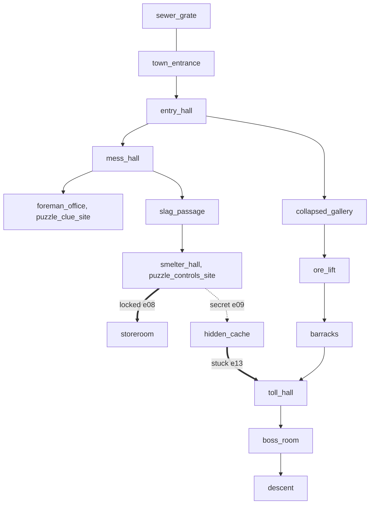

Version 3 (revision 2 of 2) | Task: T001-s016-world | Author: development-world-designer | Status: done, PROPOSAL (not approved by the user) | Evidence: STATIC design; validator EXECUTED (work/T001/map/validate_map.log)
Inputs read: GDD (CLAUDE.md import), work/T001/briefs/s016-world-designer-r2.md, prior map files, as named in the brief.
Node names: no parentheses in any node `name` in `floor1_map.json` (for example "Old ore lift, chain and drum", "Descent to floor 2, wins the demo"); the diagram labels above follow the same rule.

# Floor 1 layout, Version 3 (revision 2 of 2), PROPOSAL (not approved by the user)

Unreal maps/assets are NOT produced (NOT RUN - Unreal Engine not available). Everything here is spec and data. Data file: `floor1_map.json`; IDs there are the stable IDs used below.

## Diagram (minimap grid; x right, y down)

```
 x:   0                1               2               3
 y0                sewer_grate     town_entrance
 y1                                 entry_hall
 y2  foreman_office  mess_hall                     collapsed_gallery
 y3                  slag_passage                    ore_lift
 y4  storeroom(L)    smelter_hall                    barracks
 y5                                  hidden_cache(S)  toll_hall   (hidden_cache--toll_hall stuck)
 y6                                                  boss_room
 y7                                                  descent
```

## Rooms
| ID | Role | Encounter / trap / hidden |
|---|---|---|
| town_entrance | Entrance from town | none |
| sewer_grate | The Mysterious Figure's drain grate: in `area_upper`, beside `town_entrance` (grid x1,y0), joined by plain edge e01. PROPOSAL placement: the GDD lists the Figure among the town characters and does not say where the drain is | NPC site, no combat |
| entry_hall | Hub | none |
| mess_hall | Room | enc_mess_1: mon_type_1 |
| foreman_office | Holds `puzzle_clue_site` (carved panel) | none |
| slag_passage | Corridor | trap_dart (3 traps total) |
| smelter_hall | Holds `puzzle_controls_site`: pick rack, ore cart, furnace | none |
| storeroom | Optional reward room, locked door | trap_store (chest), loot_store_1/2 |
| hidden_cache | Hidden room, behind secret door | loot_cache_1 |
| collapsed_gallery | Room | enc_gallery_1: mon_type_2; trap_pit |
| ore_lift | Landmark: chain and drum. The Figure's task destination | enc_lift_1: mon_type_3 |
| barracks | Bandit room | enc_bandit_patrol |
| toll_hall | Crew room (not where the toll is demanded) | enc_bandit_toll |
| boss_room | The boss guards the descent and demands the toll here | enc_boss |
| descent | Only reachable through boss_room; going down wins the demo | none |

Monster types are `mon_type_1..3`; names, behaviour and alignment come from Narrative/Systems. Which creatures the gods may place is a Systems matter. Spawn rates, toll and trap effects are TBD.

**Toll and boss (PROPOSAL, per GDD "Boss Encounter"):** the boss demands the toll at `boss_room` (slot `enc_boss`); toll amounts by standing stay TBD. The bandits in `barracks` and `toll_hall` are crew: the player may fight, negotiate or befriend them; befriending individuals can influence the faction's daily assessment. Bandits present when the adventurer attacks become hostile (GDD).

## Connections and door types
| Edge | From > To | Door | Ways through without lockpicking |
|---|---|---|---|
| e01 | town_entrance > sewer_grate | plain | n/a |
| e02-e07 | entry, mess, foreman, slag, smelter links | plain | n/a |
| e04, e10, e11, e12, e14, e15 | main route | plain | n/a |
| e08 | smelter_hall > storeroom | **locked** | `["puzzle", "magic_key", "pick_lock", "break"]`: solve the puzzle (PROPOSAL; puzzle is the team's design), a magic key (one use), pick the lock, or break the door (GDD: locked doors can be picked, magicked open, or broken) |
| e09 | smelter_hall > hidden_cache | **secret** (plain once found) | search, or magic |
| e13 | hidden_cache > toll_hall | **stuck** | break only; optional shortcut |

## Routes, entrance to descent
- **Route A (main, all plain doors):** town_entrance > entry_hall > collapsed_gallery (trap_pit, mon_type_2) > ore_lift (mon_type_3) > barracks (patrol) > toll_hall (toll) > boss_room > descent. Needs no pick, no search, no breaking. The validator checks this.
- **Route B (optional):** entry_hall > mess_hall (mon_type_1) > slag_passage (trap_dart) > smelter_hall > secret e09 > hidden_cache > stuck e13 > toll_hall. Needs search and breaking; skippable.
- **Storeroom:** with the clue (foreman_office) and the controls (smelter_hall) both outside it, the door is opened by the puzzle, a magic key, or by breaking it. No lockpicking needed. Shop sells magic keys (GDD consumable), so a locked door never blocks the main route.
- Every path to the descent crosses boss_room. At `boss_room` the boss demands the toll (or the player fights or negotiates); none of this depends on a lock.

## Hidden things
hidden_cache and e09 (secret, in smelter_hall); loot in hidden_cache; trap_store is inside the storeroom. Hidden features stay concealed until found (GDD).

## Shared and persistent notes
Fog of war, shared map discovery and body retrieval use node IDs (PROPOSAL: discovery flag per node, kept per world not per character). Bodies, gear and gold stay where the character died, so every node is a possible body location. Encounter-rate `area` groups are in JSON (area_upper, area_lift, area_bandit; PROPOSAL, rates TBD). Rest-in-dungeon ambush rules are the Systems Designer's; none are invented here.

## Attachment points
| Who | Attach to | Notes |
|---|---|---|
| Systems Designer (puzzle) | `puzzle_clue_site`, `puzzle_controls_site` (ctl_pick, ctl_cart, ctl_furnace), edge e08, `puzzle.opens_edge` | Puzzle is theirs/team's; my solve-to-open-e08 is a proposal. Controls need an interaction rule (packet Decision 3) |
| Systems Designer | trap slots, encounter slots, areas | Trap kinds are placeholders |
| Narrative Designer (quest) | `sewer_grate` (giver), `ore_lift` (destination, `quest_destinations.figure_task_destination`), `puzzle_clue_site` (carving text) | Carving text and Figure's reason stay unrevealing; nothing here states who built the mine |
| Narrative | `toll_hall`, `boss_room`, `barracks` | Bandit lines |

## Handoff (PROPOSAL; split not approved)
Hand the Software Engineer: this spec; `floor1_map.json` keyed by ID; the validator and its list: reachability from `town_entrance`; boss, descent, ore_lift, sewer_grate reachable; clue and controls reachable with e08 closed; descent only via boss_room; plain-only route exists; edge endpoints and door types legal; counts (3 monster types, 3 traps, 1 puzzle, 4 door types).
Expect back: importer/builder from the JSON, validation results, problems found. I own layout; Software owns code; no design changes by Software without a map change request.

STATUS: done
OUTPUTS: work/T001/map/floor1_layout.md, work/T001/map/floor1_map.json, work/T001/map/validate_map.py, work/T001/map/validate_map.log
ISSUES: (1) Unreal not available: maps NOT RUN (user). (2) work/T001/request.md missing; brief cites it (Producer). (3) Storeroom opened by puzzle, magic key or pick is my PROPOSAL; puzzle design is Systems'. (4) Interaction rule for puzzle controls unresolved (user, packet Decision 3). (5) Whether the storeroom contents matter to progression is unspecified (Systems). (6) USER DECISION: sewer_grate is placed in area_upper beside the entrance (JSON, edge e01). The GDD lists the Figure among town characters and does not say where the drain is, so this is a PROPOSAL; if the user wants it in town, a town map is needed (Producer). (7) Break and lock/stuck rules need the Systems Designer's break rule (strength/tool, noise) which is not specified here (Systems).
